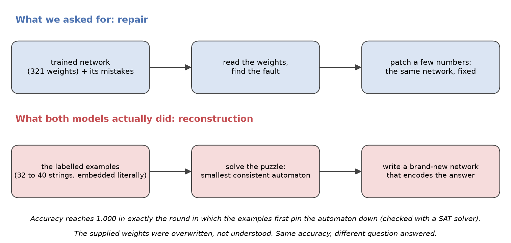
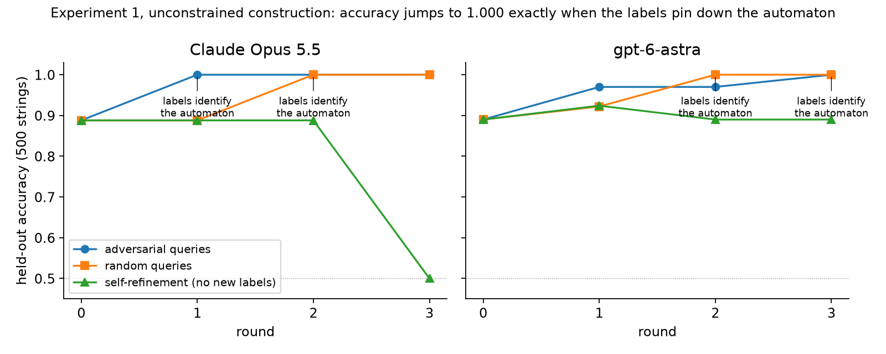
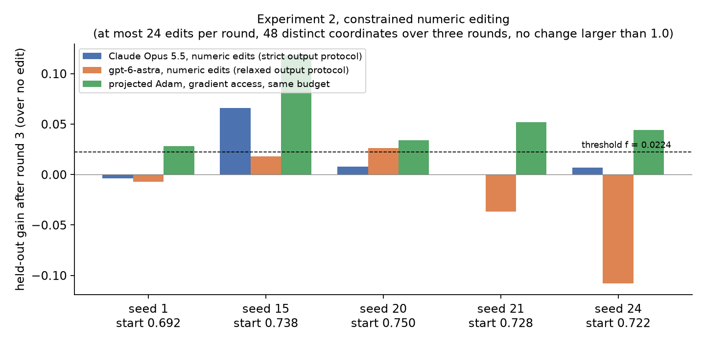
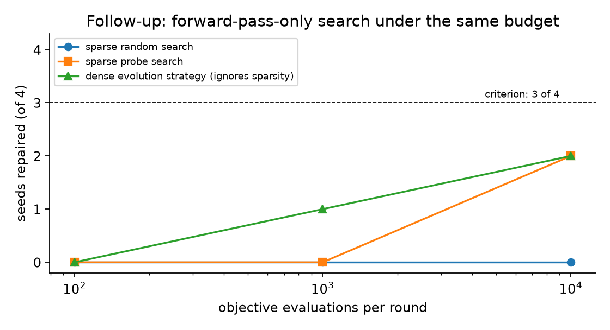

**Short answer: not in our setting, and when it looked like it could, it was doing something else.**

A trained neural network is a list of numbers. Language models read and write text, and numbers are text. So it is tempting to hand a model a small network's weights and its mistakes and ask it to fix the numbers directly, the way one patches code. We tested this under controlled conditions, with every decision rule written down before the first model call. Two findings matter.

1. **Accuracy after an edit can be real and still not be repair.** Given a free hand, two different models took a failing network to perfect accuracy. Reading their work showed how: they solved the problem itself, inferring the hidden rule from the labelled examples, and then filled in weights that encode the answer. The supplied network was replaced, not fixed.
2. **Held to small numeric edits, neither model repaired the network.** Under a budget that rules out rewriting, both models stayed within the pre-registered threshold on four of five seeds, while ordinary gradient descent, given exactly the same examples and budget, improved every seed.

Paper: [extended abstract (PDF)](https://github.com/hamley241/wsp-harness-public/blob/main/paper/main.pdf). Code, frozen rules and complete records: [the repository](https://github.com/hamley241/wsp-harness-public). Everything below can be recomputed offline from those records.

## What the models actually did

This is the part worth remembering. We asked for a repair: read the trained weights, find what is wrong, change a few numbers. What both models did instead was solve the underlying problem and then fill in weights. Their programs embedded the labelled strings literally, searched for the smallest automaton consistent with them, and wrote a fresh network that encodes that automaton in saturated weights. A SAT solver run offline confirms the timing: accuracy hits 1.000 in exactly the round in which the examples first identify the automaton uniquely, for both models and both query strategies. Before that round the models are at or near the accuracy of the best guess from the examples alone.

That is a real capability, and in a small setting an impressive one: the model is an inductive reasoner that can also hand-write a network. But it means a perfect score told us nothing about whether the model understood the network it was given. The supplied weights were overwritten, not read. Any evaluation of weight editing that scores accuracy alone cannot tell these two routes apart.

## The setting

- **Task.** Decide which binary strings belong to a hidden language defined by a six-state automaton. The correct answer is known exactly, so every claim can be checked.
- **Network.** A 16-unit recurrent network with 321 weights.
- **What the model sees.** The weights as numbers, 32 labelled strings to start, and the network's current mistakes, over three rounds. It never gets to run the network.
- **Comparison.** Doing nothing, and projected gradient descent given the same examples and the same edit budget.
- **Measurement.** Accuracy on 500 held-out strings the model never sees, plus 200 longer ones. A gain counts only above a threshold of 0.0224, one standard error at chance, fixed in advance.

## Experiment 1: a free hand, and what the accuracy hid

Both models were allowed to write the network however they liked, as a program that outputs the weights. With queries that bring in new labelled strings, accuracy jumps to 1.000 in exactly the round in which the accumulated labels pin down the automaton uniquely, as checked offline by a SAT solver. Without new labels, nothing improves. The written programs embed the labelled examples literally, search for the smallest consistent automaton, and compile it into weights. That is reconstruction from examples. It is impressive, and it is not repair.

## Experiment 2: small edits only

Now the model may change at most 24 numbers per round, 48 in total, none by more than 1.0 from its trained value. This budget excludes the rewrite route measured in Experiment 1. Both models received the frozen outcome *no repair*: at or below threshold on four of five seeds. Projected Adam under the identical budget cleared the threshold on every seed. The models' own notes say they could not simulate the network in their heads and were guessing.

## Follow-up: is the budget simply too tight for anything without gradients?

On four separate development seeds, two sparse black-box searches with forward-pass access only, under the same budget, failed a 3-of-4 criterion even at 10,000 objective evaluations per round. A dense evolution strategy that ignores the sparsity constraint did no better. So the budget is demanding without gradients; that bounds how much the negative result says about any particular editor.

## What this does and does not show

It shows that in this setting, with weights presented as numbers and no execution access, two current models did not repair the network, and that the unconstrained successes came from rebuilding it from the examples. It does not show that language models cannot repair weights in general: one task, one architecture, five seeds, two models, one budget.

The practical lesson is for anyone evaluating a claim that a language model edited a network's weights. When the labelled examples could identify the target function on their own, report what the model changed, how much, and by what route, and include a labels-only reconstruction baseline. Accuracy alone cannot tell repair from reconstruction.

## What is next

A controlled re-evaluation of a published one-shot weight-repair demonstration on a different task is in preparation, under a rule frozen before its first model call. It is a design, not a result, until its model arms have run; nothing from it is claimed on this page.

## How to check any number here

Every record, every model attempt, every charged query and every spend ledger is in the repository. The README lists the offline commands that regenerate each analysis from the raw records.

## Citing

Please cite the extended abstract in the repository's `paper/` directory, and link this page. The repository was published on 2026-11-07; the experiments were run on 2026-11-04 and 2026-11-05.
